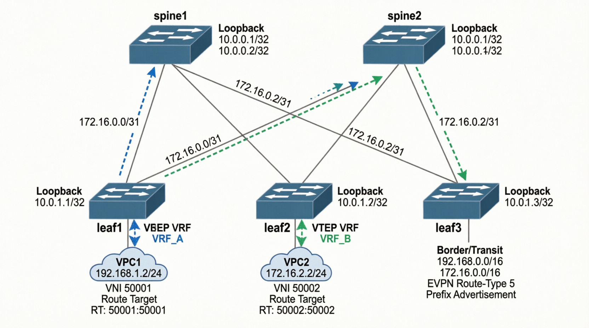

### Лабораторная работа: Реализовать передачу суммарных префиксов через EVPN route-type 

### Логическая схема фабрики (Spine-Leaf)


### Сводная таблица IP-адресации и сервисов фабрики (IP Plan & VNI Mapping)

| Устройство | Интерфейс | IP-адрес / Маска | Назначение / Роль | Уровень | VRF | L3 VNI | Route Target |
| :--- | :--- | :--- | :--- | :--- | :--- | :--- | :--- |
| **spine1** | Loopback0 | `10.0.0.11/32` | BGP Router ID / RR | Control | default | - | - |
| | Ethernet1 | `10.1.0.0/31` | Линк к leaf1 (Eth1) | Transport | default | - | - |
| | Ethernet2 | `10.1.0.2/31` | Линк к leaf2 (Eth1) | Transport | default | - | - |
| | Ethernet3 | `10.1.0.4/31` | Линк к leaf3 (Eth1) | Transport | default | - | - |
| **spine2** | Loopback0 | `10.0.0.12/32` | BGP Router ID / RR | Control | default | - | - |
| | Ethernet1 | `10.1.0.6/31` | Линк к leaf1 (Eth2) | Transport | default | - | - |
| | Ethernet2 | `10.1.0.8/31` | Линк к leaf2 (Eth2) | Transport | default | - | - |
| | Ethernet3 | `10.1.0.10/31` | Линк к leaf3 (Eth2) | Transport | default | - | - |
| **leaf1** | Loopback0 | `10.0.0.1/32` | BGP Router ID | Control | default | - | - |
| | Loopback1 | `10.0.1.1/32` | VTEP Source IP | Data | default | - | - |
| | Ethernet1 | `10.1.0.1/31` | Линк к spine1 (Eth1) | Transport | default | - | - |
| | Ethernet2 | `10.1.0.7/31` | Линк к spine2 (Eth1) | Transport | default | - | - |
| | Vlan10 | `192.168.1.1/24` | Gateway VPC1 | Data | **VRF_A** | `50001` | **Exp:** 50001:50001, **Imp:** 50001:50001, 50002:50002 |
| **VPC1** | eth0 | `192.168.1.2/24` | Хост Клиента А | Customer | **VRF_A** | - | - |
| **leaf2** | Loopback0 | `10.0.0.2/32` | BGP Router ID | Control | default | - | - |
| | Loopback1 | `10.0.1.2/32` | VTEP Source IP | Data | default | - | - |
| | Ethernet1 | `10.1.0.3/31` | Линк к spine1 (Eth2) | Transport | default | - | - |
| | Ethernet2 | `10.1.0.9/31` | Линк к spine2 (Eth2) | Transport | default | - | - |
| | Vlan20 | `172.16.2.1/24` | Gateway VPC2 | Data | **VRF_B** | `50002` | **Exp:** 50002:50002, **Imp:** 50001:50001, 50002:50002 |
| **VPC2** | eth0 | `172.16.2.2/24` | Хост Клиента Б | Customer | **VRF_B** | - | - |
| **leaf3** | Loopback0 | `10.0.0.3/32` | BGP Router ID | Control | default | - | - |
| | Loopback1 | `10.0.1.3/32` | Border VTEP | Data | default | - | - |
| | Ethernet1 | `10.1.0.5/31` | Линк к spine1 (Eth3) | Transport | default | - | - |
| | Ethernet2 | `10.1.0.11/31` | Линк к spine2 (Eth3) | Transport | default | - | - |
| | *Транзит* | `192.168.0.0/16`, `172.16.0.0/16` | Анонс Summary префиксов | Transit | **VRF_A/B** | `50001`, `50002` | **VRF_A:** Imp 50002:50002, Exp 50001:50001. **VRF_B:** Imp 50001:50001, Exp 50002:50002. |


2. ### Настроки и характеристики Underlay/Overlay
## ISIS
	```
	Spain1
	Instance  VRF      System Id        Type Interface          SNPA              State Hold time   Circuit Id
	FABRIC    default  leaf1            L2   Ethernet1          P2P               UP    28          17
	FABRIC    default  leaf2            L2   Ethernet2          P2P               UP    28          1F
	FABRIC    default  leaf3            L2   Ethernet3          P2P               UP    28          21
	```
	```
	Spain2
	Instance  VRF      System Id        Type Interface          SNPA              State Hold time   Circuit Id
	FABRIC    default  leaf1            L2   Ethernet1          P2P               UP    24          15
	FABRIC    default  leaf2            L2   Ethernet2          P2P               UP    25          1C
	FABRIC    default  leaf3            L2   Ethernet3          P2P               UP    23          22
	```
	```
	leaf1
	Instance  VRF      System Id        Type Interface          SNPA              State Hold time   Circuit Id
	FABRIC    default  spain1           L2   Ethernet1          P2P               UP    29          12
	FABRIC    default  spine2           L2   Ethernet2          P2P               UP    24          19
	```
	```
	leaf2
	Instance  VRF      System Id        Type Interface          SNPA              State Hold time   Circuit Id
	FABRIC    default  spain1           L2   Ethernet1          P2P               UP    25          14
	FABRIC    default  spine2           L2   Ethernet2          P2P               UP    28          16
	```
	```
	leaf3
	Instance  VRF      System Id        Type Interface          SNPA              State Hold time   Circuit Id
	FABRIC    default  spain1           L2   Ethernet1          P2P               UP    25          18
	FABRIC    default  spine2           L2   Ethernet2          P2P               UP    26          1B
	```
## BGP EVPN
	```
	spain1#sh bgp summary
	BGP summary information for VRF default
	Router identifier 10.0.0.11, local AS number 65000
	Neighbor           AS Session State AFI/SAFI                AFI/SAFI State   NLRI Rcd   NLRI Acc   NLRI Adv
	--------- ----------- ------------- ----------------------- -------------- ---------- ---------- ----------
	10.0.0.1        65000 Established   L2VPN EVPN              Negotiated              1          1          3
	10.0.0.2        65000 Established   L2VPN EVPN              Negotiated              1          1          3
	10.0.0.3        65000 Established   L2VPN EVPN              Negotiated              2          2          2
	10.0.0.12       65000 Established   L2VPN EVPN              Negotiated              4          4          4
	spain1#sh bgp evpn summary
	BGP summary information for VRF default
	Router identifier 10.0.0.11, local AS number 65000
	Neighbor Status Codes: m - Under maintenance
	  Neighbor  V AS           MsgRcvd   MsgSent  InQ OutQ  Up/Down State   PfxRcd PfxAcc PfxAdv
	  10.0.0.1  4 65000           1532      1544    0    0 21:24:05 Estab   1      1      3
	  10.0.0.2  4 65000           1538      1547    0    0 21:24:05 Estab   1      1      3
	  10.0.0.3  4 65000           1539      1544    0    0 21:24:05 Estab   2      2      2
	  10.0.0.12 4 65000           1538      1545    0    0 21:24:05 Estab   4      4      4
	```
	```
	spine2(config)#sh bgp summary
	BGP summary information for VRF default
	Router identifier 10.0.0.12, local AS number 65000
	Neighbor           AS Session State AFI/SAFI                AFI/SAFI State   NLRI Rcd   NLRI Acc   NLRI Adv
	--------- ----------- ------------- ----------------------- -------------- ---------- ---------- ----------
	10.0.0.1        65000 Established   L2VPN EVPN              Negotiated              1          1          3
	10.0.0.2        65000 Established   L2VPN EVPN              Negotiated              1          1          3
	10.0.0.3        65000 Established   L2VPN EVPN              Negotiated              2          2          2
	10.0.0.11       65000 Established   L2VPN EVPN              Negotiated              4          4          4
	spine2(config)#sh bgp evpn summary
	BGP summary information for VRF default
	Router identifier 10.0.0.12, local AS number 65000
	Neighbor Status Codes: m - Under maintenance
	  Neighbor  V AS           MsgRcvd   MsgSent  InQ OutQ  Up/Down State   PfxRcd PfxAcc PfxAdv
	  10.0.0.1  4 65000           1627      1623    0    0 21:57:09 Estab   1      1      3
	  10.0.0.2  4 65000           1653      1654    0    0 21:26:37 Estab   1      1      3
	  10.0.0.3  4 65000           1646      1661    0    0 21:26:23 Estab   2      2      2
	  10.0.0.11 4 65000           1546      1539    0    0 21:24:53 Estab   4      4      4
	spine2(config)#
	```
	```
	leaf1(config-router-bgp-vrf-VRF_A-af)#sh bgp summary
	BGP summary information for VRF default
	Router identifier 10.0.0.1, local AS number 65000
	Neighbor           AS Session State AFI/SAFI                AFI/SAFI State   NLRI Rcd   NLRI Acc   NLRI Adv
	--------- ----------- ------------- ----------------------- -------------- ---------- ---------- ----------
	10.0.0.11       65000 Established   L2VPN EVPN              Negotiated              3          3          1
	10.0.0.12       65000 Established   L2VPN EVPN              Negotiated              3          3          1
	leaf1(config-router-bgp-vrf-VRF_A-af)#sh bgp evpn summary
	BGP summary information for VRF default
	Router identifier 10.0.0.1, local AS number 65000
	Neighbor Status Codes: m - Under maintenance
	  Neighbor  V AS           MsgRcvd   MsgSent  InQ OutQ  Up/Down State   PfxRcd PfxAcc PfxAdv
	  10.0.0.11 4 65000           1545      1537    0    0 21:26:28 Estab   3      3      1
	  10.0.0.12 4 65000           1625      1629    0    0 21:58:43 Estab   3      3      1
	```
	```
	leaf2(config-router-bgp-vrf-VRF_B-af)#sh bgp summary
	BGP summary information for VRF default
	Router identifier 10.0.0.2, local AS number 65000
	Neighbor           AS Session State AFI/SAFI                AFI/SAFI State   NLRI Rcd   NLRI Acc   NLRI Adv
	--------- ----------- ------------- ----------------------- -------------- ---------- ---------- ----------
	10.0.0.11       65000 Established   L2VPN EVPN              Negotiated              3          3          1
	10.0.0.12       65000 Established   L2VPN EVPN              Negotiated              3          3          1
	leaf2(config-router-bgp-vrf-VRF_B-af)#sh bgp evpn summary
	BGP summary information for VRF default
	Router identifier 10.0.0.2, local AS number 65000
	Neighbor Status Codes: m - Under maintenance
	  Neighbor  V AS           MsgRcvd   MsgSent  InQ OutQ  Up/Down State   PfxRcd PfxAcc PfxAdv
	  10.0.0.11 4 65000           1551      1542    0    0 21:27:22 Estab   3      3      1
	  10.0.0.12 4 65000           1657      1656    0    0 21:29:05 Estab   3      3      1
	```
	```
	leaf3(config-router-bgp-vrf-VRF_B-af)#sh bgp summary
	BGP summary information for VRF default
	Router identifier 10.0.0.3, local AS number 65000
	Neighbor           AS Session State AFI/SAFI                AFI/SAFI State   NLRI Rcd   NLRI Acc   NLRI Adv
	--------- ----------- ------------- ----------------------- -------------- ---------- ---------- ----------
	10.0.0.11       65000 Established   L2VPN EVPN              Negotiated              2          2          2
	10.0.0.12       65000 Established   L2VPN EVPN              Negotiated              2          2          2
	leaf3(config-router-bgp-vrf-VRF_B-af)#sh bgp evpn summary
	BGP summary information for VRF default
	Router identifier 10.0.0.3, local AS number 65000
	Neighbor Status Codes: m - Under maintenance
	  Neighbor  V AS           MsgRcvd   MsgSent  InQ OutQ  Up/Down State   PfxRcd PfxAcc PfxAdv
	  10.0.0.11 4 65000           1549      1544    0    0 21:28:02 Estab   2      2      2
	  10.0.0.12 4 65000           1665      1650    0    0 21:29:32 Estab   2      2      2
	```
## VXLAN/VNI
	```
	leaf1(config)#show interfaces vxlan 1
	Vxlan1 is up, line protocol is up (connected)
	  Hardware is Vxlan
	  Description: VTEP_INTERFACE
	  Source interface is Loopback1 and is active with 10.0.1.1
	  Listening on UDP port 4789
	  Replication/Flood Mode is headend with Flood List Source: CLI
	  Remote MAC learning is disabled
	  VNI mapping to VLANs
	  Static VLAN to VNI mapping is
		[10, 10010]
	  Dynamic VLAN to VNI mapping for 'evpn' is
		[4093, 50002]     [4098, 50001]
	  Note: All Dynamic VLANs used by VCS are internal VLANs.
			Use 'show vxlan vni' for details.
	  Static VRF to VNI mapping is
	   [VRF_A, 50001]
	  Shared Router MAC is 0011.2233.4455
	leaf1(config)#show vxlan vni
	VNI to VLAN Mapping for Vxlan1
	VNI         VLAN       Source       Interface           802.1Q Tag
	----------- ---------- ------------ ------------------- ----------
	10010       10         static       Ethernet3           untagged
										Port-Channel1       untagged
										Vxlan1              10

	VNI to dynamic VLAN Mapping for Vxlan1
	VNI         VLAN       VRF         Source
	----------- ---------- ----------- ------------
	50001       4098       VRF_A       evpn
	50002       4093                   evpn
	```
	```
	leaf2(config-router-bgp-vrf-VRF_B-af)#sh interfaces vxlan 1
	Vxlan1 is up, line protocol is up (connected)
	  Hardware is Vxlan
	  Description: VTEP_INTERFACE
	  Source interface is Loopback1 and is active with 10.0.1.2
	  Listening on UDP port 4789
	  Replication/Flood Mode is headend with Flood List Source: CLI
	  Remote MAC learning is disabled
	  VNI mapping to VLANs
	  Static VLAN to VNI mapping is
		[10, 10010]
	  Dynamic VLAN to VNI mapping for 'evpn' is
		[4094, 50001]     [4099, 50002]
	  Note: All Dynamic VLANs used by VCS are internal VLANs.
			Use 'show vxlan vni' for details.
	  Static VRF to VNI mapping is
	   [VRF_B, 50002]
	  Shared Router MAC is 0011.2233.4466
	leaf2(config-router-bgp-vrf-VRF_B-af)#show vxlan vni
	VNI to VLAN Mapping for Vxlan1
	VNI         VLAN       Source       Interface           802.1Q Tag
	----------- ---------- ------------ ------------------- ----------
	10010       10         static       Port-Channel1       untagged
										Port-Channel2       untagged
										Vxlan1              10

	VNI to dynamic VLAN Mapping for Vxlan1
	VNI         VLAN       VRF         Source
	----------- ---------- ----------- ------------
	50001       4094                   evpn
	50002       4099       VRF_B       evpn
	```
	```
	leaf3(config-router-bgp-vrf-VRF_B-af)#sh interfaces vxlan 1
	Vxlan1 is up, line protocol is up (connected)
	  Hardware is Vxlan
	  Description: VTEP_INTERFACE
	  Source interface is Loopback1 and is active with 10.0.1.3
	  Listening on UDP port 4789
	  Replication/Flood Mode is headend with Flood List Source: CLI
	  Remote MAC learning is disabled
	  VNI mapping to VLANs
	  Static VLAN to VNI mapping is
		[20, 10020]
	  Dynamic VLAN to VNI mapping for 'evpn' is
		[4099, 50001]     [4100, 50002]
	  Note: All Dynamic VLANs used by VCS are internal VLANs.
			Use 'show vxlan vni' for details.
	  Static VRF to VNI mapping is
	   [VRF_A, 50001]
	   [VRF_B, 50002]
	  Shared Router MAC is 0000.0000.0000
	leaf3(config-router-bgp-vrf-VRF_B-af)#sh vxlan vni
	VNI to VLAN Mapping for Vxlan1
	VNI         VLAN       Source       Interface       802.1Q Tag
	----------- ---------- ------------ --------------- ----------
	10020       20         static       Ethernet4       untagged
										Vxlan1          20

	VNI to dynamic VLAN Mapping for Vxlan1
	VNI         VLAN       VRF         Source
	----------- ---------- ----------- ------------
	50001       4099       VRF_A       evpn
	50002       4100       VRF_B       evpn
	```

3. ## EVPN Route-Type 5
	```
	spain1#show bgp evpn route-type ip-prefix
	BGP routing table information for VRF default
	Router identifier 10.0.0.11, local AS number 65000
	Route status codes: * - valid, > - active, S - Stale, E - ECMP head, e - ECMP
						c - Contributing to ECMP, % - Pending best path selection
	Origin codes: i - IGP, e - EGP, ? - incomplete
	AS Path Attributes: Or-ID - Originator ID, C-LST - Cluster List, LL Nexthop - Link Local Nexthop

			  Network                Next Hop              Metric  LocPref Weight  Path
	 * >      RD: 10.0.0.3:50002 ip-prefix 172.16.0.0/16
									 10.0.1.3              -       100     0       ?
	 *        RD: 10.0.0.3:50002 ip-prefix 172.16.0.0/16
									 10.0.1.3              -       100     0       ? Or-ID: 10.0.0.3 C-LST: 10.0.0.12
	 * >      RD: 10.0.0.2:50002 ip-prefix 172.16.2.0/24
									 10.0.1.2              -       100     0       i
	 *        RD: 10.0.0.2:50002 ip-prefix 172.16.2.0/24
									 10.0.1.2              -       100     0       i Or-ID: 10.0.0.2 C-LST: 10.0.0.12
	 * >      RD: 10.0.0.3:50001 ip-prefix 192.168.0.0/16
									 10.0.1.3              -       100     0       ?
	 *        RD: 10.0.0.3:50001 ip-prefix 192.168.0.0/16
									 10.0.1.3              -       100     0       ? Or-ID: 10.0.0.3 C-LST: 10.0.0.12
	 * >      RD: 10.0.0.1:50001 ip-prefix 192.168.1.0/24
									 10.0.1.1              -       100     0       i
	 *        RD: 10.0.0.1:50001 ip-prefix 192.168.1.0/24
									 10.0.1.1              -       100     0       i Or-ID: 10.0.0.1 C-LST: 10.0.0.12
	```
	
	```       
	spine2(config)#show bgp evpn route-type ip-prefix
	BGP routing table information for VRF default
	Router identifier 10.0.0.12, local AS number 65000
	Route status codes: * - valid, > - active, S - Stale, E - ECMP head, e - ECMP
						c - Contributing to ECMP, % - Pending best path selection
	Origin codes: i - IGP, e - EGP, ? - incomplete
	AS Path Attributes: Or-ID - Originator ID, C-LST - Cluster List, LL Nexthop - Link Local Nexthop

			  Network                Next Hop              Metric  LocPref Weight  Path
	 * >      RD: 10.0.0.3:50002 ip-prefix 172.16.0.0/16
									 10.0.1.3              -       100     0       ?
	 *        RD: 10.0.0.3:50002 ip-prefix 172.16.0.0/16
									 10.0.1.3              -       100     0       ? Or-ID: 10.0.0.3 C-LST: 10.0.0.11
	 * >      RD: 10.0.0.2:50002 ip-prefix 172.16.2.0/24
									 10.0.1.2              -       100     0       i
	 *        RD: 10.0.0.2:50002 ip-prefix 172.16.2.0/24
									 10.0.1.2              -       100     0       i Or-ID: 10.0.0.2 C-LST: 10.0.0.11
	 * >      RD: 10.0.0.3:50001 ip-prefix 192.168.0.0/16
									 10.0.1.3              -       100     0       ?
	 *        RD: 10.0.0.3:50001 ip-prefix 192.168.0.0/16
									 10.0.1.3              -       100     0       ? Or-ID: 10.0.0.3 C-LST: 10.0.0.11
	 * >      RD: 10.0.0.1:50001 ip-prefix 192.168.1.0/24
									 10.0.1.1              -       100     0       i
	 *        RD: 10.0.0.1:50001 ip-prefix 192.168.1.0/24
									 10.0.1.1              -       100     0       i Or-ID: 10.0.0.1 C-LST: 10.0.0.11
	```
	
	```           
	leaf1#show bgp evpn route-type ip-prefix
	BGP routing table information for VRF default
	Router identifier 10.0.0.1, local AS number 65000
	Route status codes: * - valid, > - active, S - Stale, E - ECMP head, e - ECMP
						c - Contributing to ECMP, % - Pending best path selection
	Origin codes: i - IGP, e - EGP, ? - incomplete
	AS Path Attributes: Or-ID - Originator ID, C-LST - Cluster List, LL Nexthop - Link Local Nexthop

			  Network                Next Hop              Metric  LocPref Weight  Path
	 * >      RD: 10.0.0.3:50002 ip-prefix 172.16.0.0/16
									 10.0.1.3              -       100     0       ? Or-ID: 10.0.0.3 C-LST: 10.0.0.11
	 *        RD: 10.0.0.3:50002 ip-prefix 172.16.0.0/16
									 10.0.1.3              -       100     0       ? Or-ID: 10.0.0.3 C-LST: 10.0.0.12
	 * >      RD: 10.0.0.2:50002 ip-prefix 172.16.2.0/24
									 10.0.1.2              -       100     0       i Or-ID: 10.0.0.2 C-LST: 10.0.0.11
	 *        RD: 10.0.0.2:50002 ip-prefix 172.16.2.0/24
									 10.0.1.2              -       100     0       i Or-ID: 10.0.0.2 C-LST: 10.0.0.12
	 * >      RD: 10.0.0.3:50001 ip-prefix 192.168.0.0/16
									 10.0.1.3              -       100     0       ? Or-ID: 10.0.0.3 C-LST: 10.0.0.11
	 *        RD: 10.0.0.3:50001 ip-prefix 192.168.0.0/16
									 10.0.1.3              -       100     0       ? Or-ID: 10.0.0.3 C-LST: 10.0.0.12
	 * >      RD: 10.0.0.1:50001 ip-prefix 192.168.1.0/24
									 -                     -       -       0       i
	```
	
	```
	leaf2#show bgp evpn route-type ip-prefix
	BGP routing table information for VRF default
	Router identifier 10.0.0.2, local AS number 65000
	Route status codes: * - valid, > - active, S - Stale, E - ECMP head, e - ECMP
						c - Contributing to ECMP, % - Pending best path selection
	Origin codes: i - IGP, e - EGP, ? - incomplete
	AS Path Attributes: Or-ID - Originator ID, C-LST - Cluster List, LL Nexthop - Link Local Nexthop

			  Network                Next Hop              Metric  LocPref Weight  Path
	 * >      RD: 10.0.0.3:50002 ip-prefix 172.16.0.0/16
									 10.0.1.3              -       100     0       ? Or-ID: 10.0.0.3 C-LST: 10.0.0.11
	 *        RD: 10.0.0.3:50002 ip-prefix 172.16.0.0/16
									 10.0.1.3              -       100     0       ? Or-ID: 10.0.0.3 C-LST: 10.0.0.12
	 * >      RD: 10.0.0.2:50002 ip-prefix 172.16.2.0/24
									 -                     -       -       0       i
	 * >      RD: 10.0.0.3:50001 ip-prefix 192.168.0.0/16
									 10.0.1.3              -       100     0       ? Or-ID: 10.0.0.3 C-LST: 10.0.0.11
	 *        RD: 10.0.0.3:50001 ip-prefix 192.168.0.0/16
									 10.0.1.3              -       100     0       ? Or-ID: 10.0.0.3 C-LST: 10.0.0.12
	 * >      RD: 10.0.0.1:50001 ip-prefix 192.168.1.0/24
									 10.0.1.1              -       100     0       i Or-ID: 10.0.0.1 C-LST: 10.0.0.11
	 *        RD: 10.0.0.1:50001 ip-prefix 192.168.1.0/24
									 10.0.1.1              -       100     0       i Or-ID: 10.0.0.1 C-LST: 10.0.0.12
	```
	
	```
	leaf3(config)#show bgp evpn route-type ip-prefix
	BGP routing table information for VRF default
	Router identifier 10.0.0.3, local AS number 65000
	Route status codes: * - valid, > - active, S - Stale, E - ECMP head, e - ECMP
						c - Contributing to ECMP, % - Pending best path selection
	Origin codes: i - IGP, e - EGP, ? - incomplete
	AS Path Attributes: Or-ID - Originator ID, C-LST - Cluster List, LL Nexthop - Link Local Nexthop

			  Network                Next Hop              Metric  LocPref Weight  Path
	 * >      RD: 10.0.0.3:50002 ip-prefix 172.16.0.0/16
									 -                     -       -       0       ?
	 * >      RD: 10.0.0.2:50002 ip-prefix 172.16.2.0/24
									 10.0.1.2              -       100     0       i Or-ID: 10.0.0.2 C-LST: 10.0.0.11
	 *        RD: 10.0.0.2:50002 ip-prefix 172.16.2.0/24
									 10.0.1.2              -       100     0       i Or-ID: 10.0.0.2 C-LST: 10.0.0.12
	 * >      RD: 10.0.0.3:50001 ip-prefix 192.168.0.0/16
									 -                     -       -       0       ?
	 * >      RD: 10.0.0.1:50001 ip-prefix 192.168.1.0/24
									 10.0.1.1              -       100     0       i Or-ID: 10.0.0.1 C-LST: 10.0.0.11
	 *        RD: 10.0.0.1:50001 ip-prefix 192.168.1.0/24
									 10.0.1.1              -       100     0       i Or-ID: 10.0.0.1 C-LST: 10.0.0.12
	```
### Border leaf and Firewell/Router	
Тестовый пинг транзитных линков напрямую с шлюза
	```
	leaf3#ping vrf VRF_A 10.255.1.2
	PING 10.255.1.2 (10.255.1.2) 72(100) bytes of data.
	80 bytes from 10.255.1.2: icmp_seq=1 ttl=64 time=100 ms
	80 bytes from 10.255.1.2: icmp_seq=2 ttl=64 time=80.5 ms
	80 bytes from 10.255.1.2: icmp_seq=3 ttl=64 time=66.1 ms
	80 bytes from 10.255.1.2: icmp_seq=4 ttl=64 time=46.4 ms
	80 bytes from 10.255.1.2: icmp_seq=5 ttl=64 time=10.2 ms

	--- 10.255.1.2 ping statistics ---
	5 packets transmitted, 5 received, 0% packet loss, time 105ms
	rtt min/avg/max/mdev = 10.184/60.678/100.115/30.761 ms, pipe 5, ipg/ewma 26.270/78.109 ms
	leaf3#ping vrf VRF_B 10.255.2.2
	PING 10.255.2.2 (10.255.2.2) 72(100) bytes of data.
	80 bytes from 10.255.2.2: icmp_seq=1 ttl=64 time=57.9 ms
	80 bytes from 10.255.2.2: icmp_seq=2 ttl=64 time=40.2 ms
	80 bytes from 10.255.2.2: icmp_seq=3 ttl=64 time=27.1 ms
	80 bytes from 10.255.2.2: icmp_seq=4 ttl=64 time=9.50 ms
	80 bytes from 10.255.2.2: icmp_seq=5 ttl=64 time=25.0 ms

	--- 10.255.2.2 ping statistics ---
	5 packets transmitted, 5 received, 0% packet loss, time 103ms
	rtt min/avg/max/mdev = 9.496/31.932/57.869/16.227 ms, pipe 4, ipg/ewma 25.784/44.045 ms
	leaf3#
	```
	```
	leaf3#show ip route vrf VRF_A

	VRF: VRF_A
	Source Codes:
		   C - connected, S - static, K - kernel,
		   O - OSPF, O IA - OSPF inter area, O E1 - OSPF external type 1,
		   O E2 - OSPF external type 2, O N1 - OSPF NSSA external type 1,
		   O N2 - OSPF NSSA external type2, O3 - OSPFv3,
		   O3 IA - OSPFv3 inter area, O3 E1 - OSPFv3 external type 1,
		   O3 E2 - OSPFv3 external type 2,
		   O3 N1 - OSPFv3 NSSA external type 1,
		   O3 N2 - OSPFv3 NSSA external type2, B - Other BGP Routes,
		   B I - iBGP, B E - eBGP, R - RIP, I L1 - IS-IS level 1,
		   I L2 - IS-IS level 2, A B - BGP Aggregate,
		   A O - OSPF Summary, NG - Nexthop Group Static Route,
		   V - VXLAN Control Service, M - Martian,
		   DH - DHCP client installed default route,
		   DP - Dynamic Policy Route, L - VRF Leaked,
		   G  - gRIBI, RC - Route Cache Route,
		   CL - CBF Leaked Route

	Gateway of last resort is not set

	 C        10.255.1.0/30
			   directly connected, Vlan101
	 S        172.16.0.0/16 [1/0]
			   via 10.255.1.2, Vlan101
	 B I      192.168.1.0/24 [200/0]
			   via VTEP 10.0.1.1 VNI 50001 router-mac 00:11:22:33:44:55 local-interface Vxlan1

	leaf3#show ip route vrf VRF_B

	VRF: VRF_B
	Source Codes:
		   C - connected, S - static, K - kernel,
		   O - OSPF, O IA - OSPF inter area, O E1 - OSPF external type 1,
		   O E2 - OSPF external type 2, O N1 - OSPF NSSA external type 1,
		   O N2 - OSPF NSSA external type2, O3 - OSPFv3,
		   O3 IA - OSPFv3 inter area, O3 E1 - OSPFv3 external type 1,
		   O3 E2 - OSPFv3 external type 2,
		   O3 N1 - OSPFv3 NSSA external type 1,
		   O3 N2 - OSPFv3 NSSA external type2, B - Other BGP Routes,
		   B I - iBGP, B E - eBGP, R - RIP, I L1 - IS-IS level 1,
		   I L2 - IS-IS level 2, A B - BGP Aggregate,
		   A O - OSPF Summary, NG - Nexthop Group Static Route,
		   V - VXLAN Control Service, M - Martian,
		   DH - DHCP client installed default route,
		   DP - Dynamic Policy Route, L - VRF Leaked,
		   G  - gRIBI, RC - Route Cache Route,
		   CL - CBF Leaked Route

	Gateway of last resort is not set

	 C        10.255.2.0/30
			   directly connected, Vlan102
	 B I      172.16.2.0/24 [200/0]
			   via VTEP 10.0.1.2 VNI 50002 router-mac 00:11:22:33:44:66 local-interface Vxlan1
	 S        192.168.0.0/16 [1/0]
			   via 10.255.2.2, Vlan102

	leaf3#

	```
	```
	localhost#sh ip interface brief
                                                                        Address
	Interface        IP Address         Status      Protocol         MTU    Owner
	---------------- ------------------ ----------- ------------- --------- -------
	Ethernet1        10.255.1.2/30      up          up              1500
	Ethernet2        10.255.2.2/30      up          up              1500
	Management1      unassigned         up          up              1500

	localhost#show ip route

	VRF: default
	Source Codes:
		   C - connected, S - static, K - kernel,
		   O - OSPF, O IA - OSPF inter area, O E1 - OSPF external type 1,
		   O E2 - OSPF external type 2, O N1 - OSPF NSSA external type 1,
		   O N2 - OSPF NSSA external type2, O3 - OSPFv3,
		   O3 IA - OSPFv3 inter area, O3 E1 - OSPFv3 external type 1,
		   O3 E2 - OSPFv3 external type 2,
		   O3 N1 - OSPFv3 NSSA external type 1,
		   O3 N2 - OSPFv3 NSSA external type2, B - Other BGP Routes,
		   B I - iBGP, B E - eBGP, R - RIP, I L1 - IS-IS level 1,
		   I L2 - IS-IS level 2, A B - BGP Aggregate,
		   A O - OSPF Summary, NG - Nexthop Group Static Route,
		   V - VXLAN Control Service, M - Martian,
		   DH - DHCP client installed default route,
		   DP - Dynamic Policy Route, L - VRF Leaked,
		   G  - gRIBI, RC - Route Cache Route,
		   CL - CBF Leaked Route

	Gateway of last resort is not set

	 C        10.255.1.0/30
			   directly connected, Ethernet1
	 C        10.255.2.0/30
			   directly connected, Ethernet2
	 S        172.16.2.0/24 [1/0]
			   via 10.255.2.1, Ethernet2
	 S        192.168.1.0/24 [1/0]
			   via 10.255.1.1, Ethernet1
	```
4. ## Проверка прохождения трафика
```
	VPCS1> sh ip

	NAME        : VPCS[1]
	IP/MASK     : 192.168.1.2/24
	GATEWAY     : 192.168.1.1
	DNS         :
	MAC         : 00:50:79:66:68:07
	LPORT       : 20000
	RHOST:PORT  : 127.0.0.1:30000
	MTU         : 1500

	VPCS1> ping 172.16.2.2

	84 bytes from 172.16.2.2 icmp_seq=1 ttl=59 time=145.452 ms
	84 bytes from 172.16.2.2 icmp_seq=2 ttl=59 time=103.711 ms
	84 bytes from 172.16.2.2 icmp_seq=3 ttl=59 time=141.197 ms
	84 bytes from 172.16.2.2 icmp_seq=4 ttl=59 time=138.700 ms
	84 bytes from 172.16.2.2 icmp_seq=5 ttl=59 time=124.946 ms

	VPCS1> trace 172.16.2.2
	trace to 172.16.2.2, 8 hops max, press Ctrl+C to stop
	 1   192.168.1.1   16.817 ms  9.282 ms  3.652 ms
	 2   10.255.1.1   65.559 ms  49.210 ms  28.941 ms
	 3   10.255.1.2   65.009 ms  51.886 ms  77.111 ms
	 4   10.255.2.1   36.110 ms  46.250 ms  46.170 ms
	 5     *  *  *
	 6   *172.16.2.2   140.511 ms (ICMP type:3, code:3, Destination port unreachable)
```