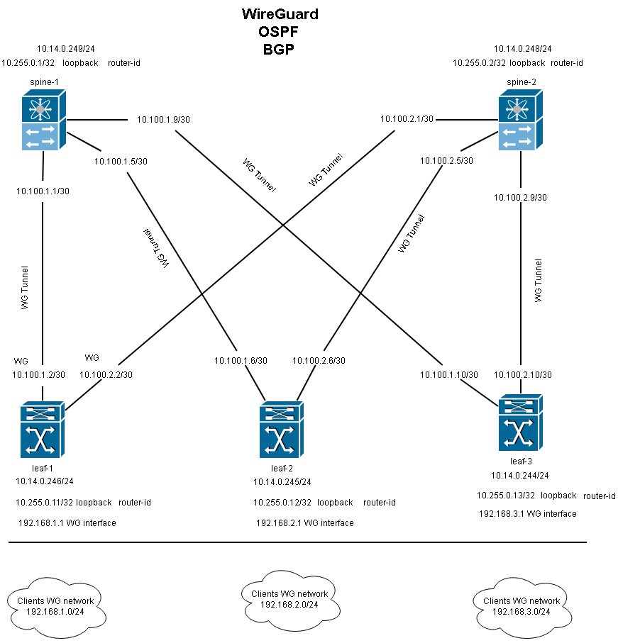
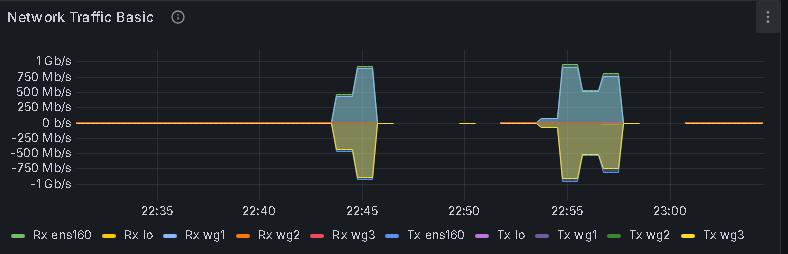
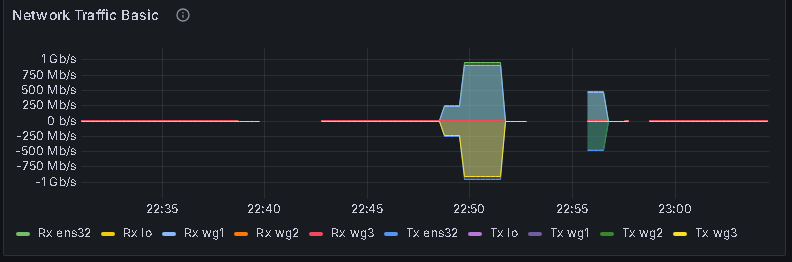
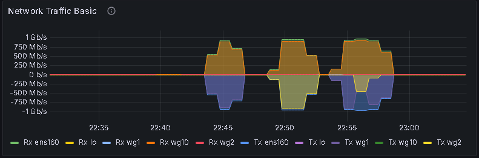
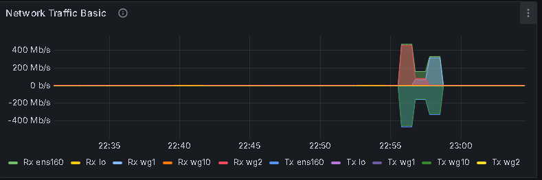
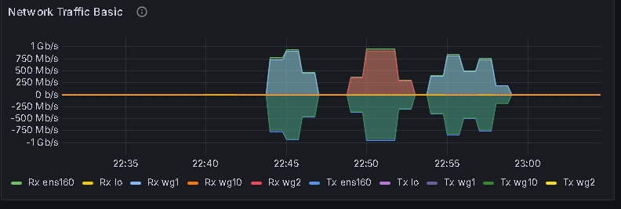

# Проектирование и реализация отказоустойчивой сетевой фабрики по архитектуре Clos (Spine-Leaf) с использованием программных маршрутизаторов FRRouting

## Оглавление
1. [Введение и архитектура сети](#1-введение-и-архитектура-сети)
   * [Сводный IP-план топологии Spine-Leaf](#сводный-ip-план-топологии-spine-leaf)
2. [Технологический стек и логика разделения уровней](#5-технологический-стек-и-логика-разделения-уровней)
   * [Underlay (Инфраструктурный транспорт)](#51-underlay-инфраструктурный-транспорт)
   * [Overlay (Сервисный слой)](#52-overlay-сервисный-слой)
3. [Балансировка нагрузки (ECMP)](#6-балансировка-нагрузки-ecmp)
4. [Результаты тестирования и отказоустойчивость](#7-результаты-тестирования-и-отказоустойчивость)
   * [Симуляция падения узла ядра (Spine-1)](#81-симуляция-падения-узла-ядра-spine-1)
   * [Проверка пропускного канала и MTU со стороны Windows-клиентов](#82-проверка-пропускного-канала-и-mtu-со-стороны-windows-клиентов)
5. [Демонстрация листингов конфигурации устройств Spine, Leaf](#9-демонстрация-листингов-кофигурации-устройств-spineleaf)
   * [Underlay - Конфигурация WireGuard интерфейсов](#91-underlay---конфигурация-wireguard-итерфейсов-инфраструктурный-транспорт)
   * [Конфигурация FRRouting Spine, Leaf (OSPF/BGP)](#92-конфигурация-frrouting-spineleaf-ospfbgp)
6. [Демонстрация консольного вывода настроек протоколов BGP и OSPF](#10-демонстрация-консольного-вывода-настроек-протоколов-bgp-и-ospf)
7. [Заключение](#заключение)

---

## 1. Введение и архитектура сети



В данной работе представлена реализация распределенной сетевой инфраструктуры высокой доступности, построенной по классической двухъярусной архитектуре Clos (Clos Spine-Leaf). В качестве аппаратной базы используются **5 виртуальных выделенных серверов (VPS)** под управлением операционной системы **Ubuntu 24.04 LTS**. Маршрутизация трафика обеспечивается программным комплексом **FRRouting (FRR)**.

Топология сети состоит из двух уровней:
*   **Уровень ядра (Spine):** Маршрутизаторы `s1` (Spine-1) и `s2` (Spine-2). Их задача — высокоскоростная коммутация транзитного трафика между фабриками без подключения конечных клиентов.
*   **Уровень границы (Leaf):** Маршрутизаторы `lf1`, `lf2`, `lf3`. Обеспечивают подключение клиентских сегментов.

Каждый Leaf-маршрутизатор подключен к каждому Spine-маршрутизатору, образуя полносвязную избыточную топологию. Прямые связи между маршрутизаторами одного уровня отсутствуют.

### 📊 Сводный IP-план топологии Spine-Leaf

#### 1. Инфраструктурные интерфейсы (Loopback / Router ID)
Используются для уникальной идентификации маршрутизаторов в протоколах OSPF и BGP, а также для управления (Management).

| Имя устройства | Роль в сети | Loopback IP-адрес | Маска / CIDR | Назначение |
| :--- | :--- | :--- | :--- | :--- |
| **spine-1** | Центральный коммутатор 1 | `10.255.0.1` | 255.255.255.255 (/32) | Router-ID / OSPF / BGP |
| **spine-2** | Центральный коммутатор 2 | `10.255.0.2` | 255.255.255.255 (/32) | Router-ID / OSPF / BGP |
| **leaf-1** | Граничный коммутатор 1 | `10.255.0.11` | 255.255.255.255 (/32) | Router-ID / OSPF / BGP |
| **leaf-2** | Граничный коммутатор 2 | `10.255.0.12` | 255.255.255.255 (/32) | Router-ID / OSPF / BGP |
| **leaf-3** | Граничный коммутатор 3 | `10.255.0.13` | 255.255.255.255 (/32) | Router-ID / OSPF / BGP |

#### 2. Физические LAN-интерфейсы управления (Management Networks)
Локальные подсети, в которых находятся физические интерфейсы оборудования для первоначальной настройки и менеджмента.

| Имя устройства | Сетевой интерфейс | IP-адрес узла | Сеть / Маска / CIDR |
| :--- | :--- | :--- | :--- |
| **spine-1** | Физический (LAN) | `10.14.0.249` | 10.14.0.0 / 255.255.255.0 (/24) |
| **spine-2** | Физический (LAN) | `10.14.0.248` | 10.14.0.0 / 255.255.255.0 (/24) |
| **leaf-1** | Физический (LAN) | `10.14.0.246` | 10.14.0.0 / 255.255.255.0 (/24) |
| **leaf-2** | Физический (LAN) | `10.14.0.245` | 10.14.0.0 / 255.255.255.0 (/24) |
| **leaf-3** | Физический (LAN) | `10.14.0.244` | 10.14.0.0 / 255.255.255.0 (/24) |

#### 3. Магистральные туннели (WireGuard Point-to-Point)
Связующие криптографические линки между уровнями Spine и Leaf. Каждый линк изолирован в подсеть `/30`.

| Имя линка на схеме | Сторона А (Spine) | Сторона Б (Leaf) | Сеть подсеть / CIDR |
| :--- | :--- | :--- | :--- |
| **spine-1 ↔ leaf-1** | `10.100.1.1` | `10.100.1.2` | 10.100.1.0 / 255.255.255.252 (/30) |
| **spine-1 ↔ leaf-2** | `10.100.1.5` | `10.100.1.6` | 10.100.1.4 / 255.255.255.252 (/30) |
| **spine-1 ↔ leaf-3** | `10.100.1.9` | `10.100.1.10` | 10.100.1.8 / 255.255.255.252 (/30) |
| **spine-2 ↔ leaf-1** | `10.100.2.1` | `10.100.2.2` | 10.100.2.0 / 255.255.255.252 (/30) |
| **spine-2 ↔ leaf-2** | `10.100.2.5` | `10.100.2.6` | 10.100.2.4 / 255.255.255.252 (/30) |
| **spine-2 ↔ leaf-3** | `10.100.2.9` | `10.100.2.10` | 10.100.2.8 / 255.255.255.252 (/30) |

#### 4. Пользовательские подсети (Clients WG Networks)
Подсети филиалов или конечных клиентов, которые терминируются на коммутаторах уровня Leaf.

| Устройство обслуживания | Интерфейс шлюза | Клиентская подсеть | Маска / CIDR | Диапазон адресов клиентов |
| :--- | :--- | :--- | :--- | :--- |
| **leaf-1** | `192.168.1.1` | `192.168.1.0` | 255.255.255.0 (/24) | 192.168.1.2 – 192.168.1.254 |
| **leaf-2** | `192.168.2.1` | `192.168.2.0` | 255.255.255.0 (/24) | 192.168.2.2 – 192.168.2.254 |
| **leaf-3** | `192.168.3.1` | `192.168.3.0` | 255.255.255.0 (/24) | 192.168.3.2 – 192.168.3.254 |

---

## 5. Технологический стек и логика разделения уровней

Сетевая связность разделена на два независимых слоя (Underlay и Overlay) для обеспечения максимальной масштабируемости и стабильности системы.

### 5.1. Underlay (Инфраструктурный транспорт)
В качестве физических каналов связи между VPS развернуты защищенные туннели Point-to-Point на базе **WireGuard**. С целью изоляции служебного трафика в параметрах `AllowedIPs` WireGuard разрешены только точечные IP-адреса интерфейсов соседа. Маршрутизация внутри туннелей обеспечивается протоколом **OSPFv2**. 

Поскольку интерфейсы WireGuard не поддерживают широковещательную рассылку (Multicast) по умолчанию, OSPF переведен в режим неколлизионного юникаста — **Point-to-Multipoint Non-Broadcast (NBMA)** с явным статическим указанием соседей через директиву `neighbor`.

Основная задача OSPF на уровне Underlay — обеспечение связности стабильных виртуальных интерфейсов Loopback (`10.255.0.X/32`), закрепленных за каждым маршрутизатором фабрики. Служебный протокол OSPF полностью изолирован от флуктуаций клиентских сетей.

### 5.2. Overlay (Сервисный слой)
Для передачи маршрутной информации конечных клиентов используется протокол **BGP** в рамках единой автономной системы `AS 65000`. BGP-сессии строятся непосредственно поверх Loopback-адресов маршрутизаторов, доступность которых гарантирована нижележащим слоем OSPF.

Для исключения требования полносвязной конфигурации сессий (Full Mesh) на уровне BGP, Spine-маршрутизаторы переведены в режим **BGP Route Reflector (RR)**. Лифы выступают в роли клиентов отражения. 

Клиентские подсети выделены в изолированном адресном пространстве `192.168.0.0/16`:
*   Сегмент Leaf-1: `192.168.1.0/24`
*   Сегмент Leaf-2: `192.168.2.0/24`
*   Сегмент Leaf-3: `192.168.3.0/24`

Клиентские устройства подключаются к интерфейсам `wg10` на Leaf-маршрутизаторах, после чего подсети динамически анонсируются в фабрику через команду `network` в BGP.

---

## 6. Балансировка нагрузки (ECMP)

BGP передаёт маршрут клиентской сети с next-hop на удалённом Leaf. OSPF обеспечивает два равнозначных пути до этого next-hop через оба Spine, поэтому трафик может идти по двум WG-туннелям.

---

## 8. Результаты тестирования и отказоустойчивость

В рамках практических испытаний к клиентским подсетям фабрики были подключены три конечные рабочие станции под управлением **ОС Windows**. На них были смоделированы критические сбои и сценарии пиковой нагрузки.


## 8.1. Симуляция падения узла ядра (Spine-2) и конвергенция сети

В рамках тестирования отказоустойчивости на Windows-клиенте из первого сегмента (192.168.1.10) был запущен непрерывный мониторинг связности с помощью утилиты ping в сторону хостов во втором сегменте (192.168.2.10) и третьем сегменте (192.168.3.10). В процессе передачи трафика моделировалось аварийное отключение и последующее включение центрального маршрутизатора ядра Spine-2 (s2).

### 1. Трассировка маршрутов до инцидента (Балансировка трафика)

До отключения Spine-2 сетевой стек распределял потоки к разным Лифам через разные Спайны:
• Маршрут к 192.168.2.10 строился через Spine-2 (10.100.2.1 → 10.100.2.6).
• Маршрут к 192.168.3.10 строился через Spine-1 (10.100.1.1 → 10.100.1.10).
cmd
```
C:\Users\usr1>tracert 192.168.2.10
  1    <1 мс    <1 мс    <1 мс  192.168.1.1
  2     1 ms    <1 мс    <1 мс  10.100.2.1 (Spine-2)
  3     1 ms     1 ms     7 ms  10.100.2.6
  4     2 ms     1 ms     1 ms  192.168.2.10
```
```
C:\Users\usr1>tracert 192.168.3.10
  1    <1 мс    <1 мс    <1 мс  192.168.1.1
  2     1 ms    <1 мс     2 ms  10.100.1.1 (Spine-1)
  3     1 ms     1 ms     1 ms  10.100.1.10
  4     2 ms     1 ms     1 ms  192.168.3.10
```

### 2. Динамика сходимости при падении Spine-2 (Интервал 22:38)

В 22:38:04 было произведено физическое отключение интерфейсов Spine-2. В этот момент поток трафика к 192.168.3.10 не пострадал (так как изначально шел через Spine-1), но поток к 192.168.2.10 зафиксировал прерывание связи со стороны Windows-клиента:
```
22.10.2026 22:38:04 - Ответ от 192.168.2.10: число байт=32 время=2мс TTL=125
22.10.2026 22:38:09 - Превышен интервал ожидания для запроса.
22.10.2026 22:38:14 - Превышен интервал ожидания для запроса.
22.10.2026 22:38:19 - Превышен интервал ожидания для запроса.
22.10.2026 22:38:24 - Превышен интервал ожидания для запроса.
22.10.2026 22:38:29 - Превышен интервал ожидания для запроса.
22.10.2026 22:38:34 - Превышен интервал ожидания для запроса.
22.10.2026 22:38:39 - Превышен интервал ожидания для запроса.
22.10.2026 22:38:40 - Ответ от 192.168.2.10: число байт=32 время=2мс TTL=125
```
Сходимость протоколов заняла ровно 7 секунд, в течение которых было потеряно 7 пакетов. Связность восстановилась автоматически.

3. Трассировка маршрутов после падения Spine-2

Проверка маршрута утилитой tracert показала, что сетевая фабрика успешно перестроила пути. Трафик к хосту 192.168.2.10, который ранее шел через упавший Spine-2, автоматически перенаправлен в туннель первого коммутатора ядра Spine-1 (10.100.1.1 → 10.100.1.6):
cmd
```
C:\Users\usr1>tracert 192.168.2.10
  1    <1 мс    <1 мс    <1 мс  192.168.1.1
  2     1 ms    <1 мс    <1 мс  10.100.1.1 (Spine-1)
  3     1 ms     1 ms    <1 мс  10.100.1.6
  4     2 ms     1 ms     1 ms  192.168.2.10
```

В 22:40 работа Spine-2 была восстановлена. Сетевой стек Linux и протокол OSPF обнаружили появление второго равнозначного маршрута и без единой потери пакетов вернули фабрику в исходное состояние.
cmd
```
C:\Users\usr1>tracert 192.168.2.10
  1    <1 мс    <1 мс    <1 мс  192.168.1.1
  2     2 ms    <1 мс    <1 мс  10.100.2.1 (Трафик вернулся на Spine-2)
  3     1 ms     1 ms    <1 мс  10.100.2.6
  4     2 ms     1 ms     1 ms  192.168.2.10
```

Итоговая статистика испытаний

Длительный стресс-тест сети с серией многократных отключений и включений резервных магистралей показал следующие результаты:
• Для направления Leaf-1 ↔ Leaf-2: отправлен 2031 пакет, получено 1967, потеряно 64 пакета (всего 3% потерь за весь период множественных аварий).
• Для направления Leaf-1 ↔ Leaf-3: отправлен 2186 пакетов, получено 2159, потеряно 27 пакетов (всего 1% потерь).


### 8.1. Проверка максимального MTU со стороны Windows-клиентов
С рабочей станции Windows первого сегмента был запущен диагностический пинг в сторону третьего сегмента с флагом запрета фрагментации (`-f`) и размером полезной нагрузки 1392 байта (`-l 1392`):

```cmd
C:\Users\usr1>ping 192.168.3.10 -f -l 1392

Обмен пакетами с 192.168.3.10 по с 1392 байтами данных:
Ответ от 192.168.3.10: число байт=1392 время=2мс TTL=125
Ответ от 192.168.3.10: число байт=1392 время=2мс TTL=125
Ответ от 192.168.3.10: число байт=1392 время=2мс TTL=125
Ответ от 192.168.3.10: число байт=1392 время=2мс TTL=125

Статистика Ping для 192.168.3.10:
    Пакетов: отправлено = 4, получено = 4, потеряно = 0
    (0% потерь)
Приблизительное время приема-передачи в мс:
    Минимальное = 2мсек, Максимальное = 2 мсек, Среднее = 2 мсек

C:\Users\usr1>
```

---

## 9. Демонстрация листингов конфигурации устройств Spine, Leaf.

### 9.1. Underlay - Конфигурация WireGuard интерфейсов (Инфраструктурный транспорт)

### Spine1
#### wg1.conf
```ini
[Interface]
PrivateKey = приватный ключ сервера
ListenPort = 51821
Address = 10.100.1.1/30
Table = off

PostUp = ip route add 224.0.0.5/32 dev wg1 proto static 2>/dev/null || true; ip route add 224.0.0.6/32 dev wg1 proto static 2>/dev/null || true
PostDown = ip route del 224.0.0.5/32 dev wg1 2>/dev/null || true; ip route del 224.0.0.6/32 dev wg1 2>/dev/null || true

[Peer]
PublicKey = публичный ключ клиента
Endpoint = 10.14.0.246:51821
AllowedIPs = 0.0.0.0/0, 224.0.0.0/24
PersistentKeepalive = 25
```
#### wg2.conf
```ini
[Interface]
PrivateKey = приватный ключ сервера
ListenPort = 51822
Address = 10.100.1.5/30
Table = off

PostUp = ip route add 224.0.0.5/32 dev wg2 proto static 2>/dev/null || true; ip route add 224.0.0.6/32 dev wg2 proto static 2>/dev/null || true
PostDown = ip route del 224.0.0.5/32 dev wg2 2>/dev/null || true; ip route del 224.0.0.6/32 dev wg2 2>/dev/null || true

[Peer]
PublicKey = публичный ключ клиента
Endpoint = 10.14.0.245:51821
AllowedIPs = 0.0.0.0/0, 224.0.0.0/24
PersistentKeepalive = 25
```
#### wg3.conf
```ini
[Interface]
PrivateKey = приватный ключ сервера
ListenPort = 51823
Address = 10.100.1.9/30
Table = off

PostUp = ip route append 224.0.0.5/32 dev wg3 proto static 2>/dev/null || true; ip route append 224.0.0.6/32 dev wg3 proto static 2>/dev/null || true
PostDown = ip route del 224.0.0.5/32 dev wg3 2>/dev/null || true; ip route del 224.0.0.6/32 dev wg3 2>/dev/null || true

[Peer]
PublicKey = публичный ключ клиента
Endpoint = 10.14.0.244:51821
AllowedIPs = 0.0.0.0/0, 224.0.0.0/24
```

### Spine2
#### wg1.conf
```ini
[Interface]
PrivateKey = Приватный ключ сервера
ListenPort = 51821
Address = 10.100.2.1/30
Table = off

PostUp = ip route append 224.0.0.5/32 dev wg1 proto static 2>/dev/null || true; ip route append 224.0.0.6/32 dev wg1 proto static 2>/dev/null || true
PostDown = ip route del 224.0.0.5/32 dev wg1 2>/dev/null || true; ip route del 224.0.0.6/32 dev wg1 2>/dev/null || true

[Peer]
PublicKey = Публичный ключ клиента
Endpoint = 10.14.0.246:51822
AllowedIPs = 0.0.0.0/0, 224.0.0.0/24
PersistentKeepalive = 25
```
#### wg2.conf
```ini
[Interface]
PrivateKey = Приватный ключ клиента
ListenPort = 51822
Address = 10.100.2.5/30
Table = off

PostUp = ip route append 224.0.0.5/32 dev wg2 proto static 2>/dev/null || true; ip route append 224.0.0.6/32 dev wg2 proto static 2>/dev/null || true
PostDown = ip route del 224.0.0.5/32 dev wg2 2>/dev/null || true; ip route del 224.0.0.6/32 dev wg2 2>/dev/null || true

[Peer]
PublicKey = Публичный ключ клиента
Endpoint = 10.14.0.245:51822
AllowedIPs = 0.0.0.0/0, 224.0.0.0/24
PersistentKeepalive = 25
```
#### wg3.conf
```ini
[Interface]
PrivateKey = Приватный ключ клиента
ListenPort = 51823
Address = 10.100.2.9/30
Table = off

PostUp = ip route append 224.0.0.5/32 dev wg3 proto static 2>/dev/null || true; ip route append 224.0.0.6/32 dev wg3 proto static 2>/dev/null || true
PostDown = ip route del 224.0.0.5/32 dev wg3 2>/dev/null || true; ip route del 224.0.0.6/32 dev wg3 2>/dev/null || true

[Peer]
PublicKey = Публичный ключ клиента
Endpoint = 10.14.0.244:51822
AllowedIPs = 0.0.0.0/0, 224.0.0.0/24
PersistentKeepalive = 25
```

### Leaf1
#### wg1.conf
```ini
[Interface]
PrivateKey = Приватный ключ сервера
ListenPort = 51821
Address = 10.100.1.2/30
Table = off

PostUp = ip route append 224.0.0.5/32 dev wg1 proto static 2>/dev/null || true; ip route append 224.0.0.6/32 dev wg1 proto static 2>/dev/null || true
PostDown = ip route del 224.0.0.5/32 dev wg1 2>/dev/null || true; ip route del 224.0.0.6/32 dev wg1 2>/dev/null || true

[Peer]
PublicKey = Публичный ключ клиента
Endpoint = 10.14.0.249:51821
AllowedIPs = 0.0.0.0/0, 224.0.0.0/24
PersistentKeepalive = 25
```
#### wg2.conf
```ini
[Interface]
PrivateKey = 
ListenPort = 51822
Address = 10.100.2.2/30
Table = off

PostUp = ip route append 224.0.0.5/32 dev wg2 proto static 2>/dev/null || true; ip route append 224.0.0.6/32 dev wg2 proto static 2>/dev/null || true
PostDown = ip route del 224.0.0.5/32 dev wg2 2>/dev/null || true; ip route del 224.0.0.6/32 dev wg2 2>/dev/null || true

[Peer]
PublicKey = 
Endpoint = 10.14.0.248:51821
AllowedIPs = 0.0.0.0/0, 224.0.0.0/24
PersistentKeepalive = 25
```
#### wg10.conf Клиентская подсеть
```ini
[Interface]
PrivateKey = 
ListenPort = 51830
Address = 192.168.1.1/24

[Peer]
PublicKey = 
AllowedIPs = 192.168.1.10/32
```

### Leaf2
#### wg1.conf
```ini
[Interface]
PrivateKey = 
ListenPort = 51821
Address = 10.100.1.6/30
Table = off

PostUp = ip route append 224.0.0.5/32 dev wg1 proto static 2>/dev/null || true; ip route append 224.0.0.6/32 dev wg1 proto static 2>/dev/null || true
PostDown = ip route del 224.0.0.5/32 dev wg1 2>/dev/null || true; ip route del 224.0.0.6/32 dev wg1 2>/dev/null || true

[Peer]
PublicKey = 
Endpoint = 10.14.0.249:51822
AllowedIPs = 0.0.0.0/0, 224.0.0.0/24
PersistentKeepalive = 25
```
#### wg2.conf
```ini
[Interface]
PrivateKey = 
ListenPort = 51822
Address = 10.100.2.6/30
Table = off

PostUp = ip route append 224.0.0.5/32 dev wg2 proto static 2>/dev/null || true; ip route append 224.0.0.6/32 dev wg2 proto static 2>/dev/null || true
PostDown = ip route del 224.0.0.5/32 dev wg2 2>/dev/null || true; ip route del 224.0.0.6/32 dev wg2 2>/dev/null || true

[Peer]
PublicKey = 
Endpoint = 10.14.0.248:51822
AllowedIPs = 0.0.0.0/0, 224.0.0.0/24
PersistentKeepalive = 25
```
#### wg10.conf Клиентская подсеть
```ini
[Interface]
PrivateKey = 
ListenPort = 51830
Address = 192.168.2.1/24

[Peer]
PublicKey = 
AllowedIPs = 192.168.2.10/32
```

### Leaf3
#### wg1.conf
```ini
[Interface]
PrivateKey = 
ListenPort = 51821
Address = 10.100.1.10/30
Table = off

PostUp = ip route append 224.0.0.5/32 dev wg1 proto static 2>/dev/null || true; ip route append 224.0.0.6/32 dev wg1 proto static 2>/dev/null || true
PostDown = ip route del 224.0.0.5/32 dev wg1 2>/dev/null || true; ip route del 224.0.0.6/32 dev wg1 2>/dev/null || true

[Peer]
PublicKey = 
Endpoint = 10.14.0.249:51823
AllowedIPs = 0.0.0.0/0, 224.0.0.0/24
PersistentKeepalive = 25
```
#### wg2.conf
```ini
[Interface]
PrivateKey = 
ListenPort = 51822
Address = 10.100.2.10/30
Table = off

PostUp = ip route append 224.0.0.5/32 dev wg2 proto static 2>/dev/null || true; ip route append 224.0.0.6/32 dev wg2 proto static 2>/dev/null || true
PostDown = ip route del 224.0.0.5/32 dev wg2 2>/dev/null || true; ip route del 224.0.0.6/32 dev wg2 2>/dev/null || true

[Peer]
PublicKey = 
Endpoint = 10.14.0.248:51823
AllowedIPs = 0.0.0.0/0, 224.0.0.0/24
PersistentKeepalive = 25
```
#### wg10.conf Клиентская подсеть
```ini
[Interface]
PrivateKey = 
ListenPort = 51830
Address = 192.168.3.1/24

[Peer]
PublicKey = 
AllowedIPs = 192.168.3.10/32
```

### 9.2. Конфигурация FRRouting Spine, Leaf (OSPF/BGP)

#### Spine1 /etc/frr/frr.conf
```ini
frr version 8.1
frr defaults traditional
hostname s1
log syslog informational
no ipv6 forwarding
service integrated-vtysh-config
!
router bgp 65000
 bgp router-id 10.255.0.1
 no bgp ebgp-requires-policy
 neighbor 10.255.0.11 remote-as 65000
 neighbor 10.255.0.11 update-source lo
 neighbor 10.255.0.12 remote-as 65000
 neighbor 10.255.0.12 update-source lo
 neighbor 10.255.0.13 remote-as 65000
 neighbor 10.255.0.13 update-source lo
 !
 address-family ipv4 unicast
  neighbor 10.255.0.11 route-reflector-client
  neighbor 10.255.0.12 route-reflector-client
  neighbor 10.255.0.13 route-reflector-client
  maximum-paths 64
 exit-address-family
exit
!
router ospf
 ospf router-id 10.255.0.1
 network 10.100.1.0/24 area 0
 network 10.255.0.1/32 area 0
exit
!
```

#### Spine2 /etc/frr/frr.conf
```ini
frr version 8.1
frr defaults traditional
hostname s2
log syslog informational
no ipv6 forwarding
service integrated-vtysh-config
!
router bgp 65000
 bgp router-id 10.255.0.2
 no bgp ebgp-requires-policy
 neighbor 10.255.0.11 remote-as 65000
 neighbor 10.255.0.11 update-source lo
 neighbor 10.255.0.12 remote-as 65000
 neighbor 10.255.0.12 update-source lo
 neighbor 10.255.0.13 remote-as 65000
 neighbor 10.255.0.13 update-source lo
 !
 address-family ipv4 unicast
  neighbor 10.255.0.11 route-reflector-client
  neighbor 10.255.0.12 route-reflector-client
  neighbor 10.255.0.13 route-reflector-client
  maximum-paths 64
 exit-address-family
exit
!
router ospf
 ospf router-id 10.255.0.2
 network 10.100.2.0/24 area 0
 network 10.255.0.2/32 area 0
exit
!
```

#### Leaf1 /etc/frr/frr.conf
```ini
frr version 8.1
frr defaults traditional
hostname lf1
log syslog informational
no ipv6 forwarding
service integrated-vtysh-config
!
router bgp 65000
 bgp router-id 10.255.0.11
 no bgp ebgp-requires-policy
 neighbor 10.255.0.1 remote-as 65000
 neighbor 10.255.0.1 update-source lo
 neighbor 10.255.0.2 remote-as 65000
 neighbor 10.255.0.2 update-source lo
 !
 address-family ipv4 unicast
  network 10.1.0.0/24
  network 192.168.1.0/24
  maximum-paths 64
 exit-address-family
exit
!
router ospf
 ospf router-id 10.255.0.11
 network 10.100.1.0/24 area 0
 network 10.100.2.0/24 area 0
 network 10.255.0.11/32 area 0
exit
!
```

#### Leaf2 /etc/frr/frr.conf
```ini
frr version 8.1
frr defaults traditional
hostname lf2
log syslog informational
no ipv6 forwarding
service integrated-vtysh-config
!
router bgp 65000
 bgp router-id 10.255.0.12
 no bgp ebgp-requires-policy
 neighbor 10.255.0.1 remote-as 65000
 neighbor 10.255.0.1 update-source lo
 neighbor 10.255.0.2 remote-as 65000
 neighbor 10.255.0.2 update-source lo
 !
 address-family ipv4 unicast
  network 10.2.0.0/24
  network 192.168.2.0/24
  maximum-paths 64
 exit-address-family
exit
!
router ospf
 ospf router-id 10.255.0.12
 network 10.100.1.0/24 area 0
 network 10.100.2.0/24 area 0
 network 10.255.0.12/32 area 0
exit
!
```

#### Leaf3 /etc/frr/frr.conf
```ini
frr version 8.1
frr defaults traditional
hostname lf3
log syslog informational
no ipv6 forwarding
service integrated-vtysh-config
!
router bgp 65000
 bgp router-id 10.255.0.13
 no bgp ebgp-requires-policy
 neighbor 10.255.0.1 remote-as 65000
 neighbor 10.255.0.1 update-source lo
 neighbor 10.255.0.2 remote-as 65000
 neighbor 10.255.0.2 update-source lo
 !
 address-family ipv4 unicast
  network 10.3.0.0/24
  network 192.168.3.0/24
  maximum-paths 64
 exit-address-family
exit
!
router ospf
 ospf router-id 10.255.0.13
 network 10.100.1.0/24 area 0
 network 10.100.2.0/24 area 0
 network 10.255.0.13/32 area 0
exit
!
```

---

## 10. Демонстрация консольного вывода настроек протоколов BGP и OSPF.

### Spine1
```text
s1# show ip route
...
O   10.100.1.0/30 [110/10] is directly connected, wg1, weight 1, 03:15:06
C>* 10.100.1.0/30 is directly connected, wg1, 03:15:06
...
O>* 10.255.0.2/32 [110/20] via 10.100.1.2, wg1, weight 1, 03:14:58
  *                        via 10.100.1.6, wg2, weight 1, 03:14:58
  *                        via 10.100.1.10, wg3, weight 1, 03:14:58
...
B>  192.168.1.0/24 [200/0] via 10.255.0.11 (recursive), weight 1, 03:14:47
  *                          via 10.100.1.2, wg1, weight 1, 03:14:47
...
s1# show ip ospf neighbor
Neighbor ID     Pri State           Dead Time Address         Interface
10.255.0.13       1 Full/DROther      33.076s 10.100.1.10     wg3:10.100.1.9
10.255.0.12       1 Full/DROther      33.076s 10.100.1.6      wg2:10.100.1.5
10.255.0.11       1 Full/DROther      35.514s 10.100.1.2      wg1:10.100.1.1

s1# show ip bgp summary
Neighbor        V         AS   MsgRcvd   MsgSent   TblVer  InQ OutQ  Up/Down State/PfxRcd
10.255.0.11     4      65000       208       205        0    0    0 03:15:20            1
10.255.0.12     4      65000       205       205        0    0    0 03:15:22            1
10.255.0.13     4      65000       205       204        0    0    0 03:15:22            1
```

### Spine2
```text
s2# show ip route
...
O>* 10.255.0.1/32 [110/20] via 10.100.2.2, wg1, weight 1, 03:19:14
  *                        via 10.100.2.6, wg2, weight 1, 03:19:14
  *                        via 10.100.2.10, wg3, weight 1, 03:19:14
...
s2# show ip ospf neighbor
Neighbor ID     Pri State           Dead Time Address         Interface
10.255.0.12       1 Full/DROther      36.115s 10.100.2.6      wg2:10.100.2.5
10.255.0.11       1 Full/DROther      30.866s 10.100.2.2      wg1:10.100.2.1
10.255.0.13       1 Full/DROther      37.793s 10.100.2.10     wg3:10.100.2.9
```

### Leaf1
```text
lf1# show ip route
...
B>  192.168.2.0/24 [200/0] via 10.255.0.12 (recursive), weight 1, 03:28:10
  *                          via 10.100.1.1, wg1, weight 1, 03:28:10
  *                          via 10.100.2.1, wg2, weight 1, 03:28:10
B>  192.168.3.0/24 [200/0] via 10.255.0.13 (recursive), weight 1, 03:28:10
  *                          via 10.100.1.1, wg1, weight 1, 03:28:10
  *                          via 10.100.2.1, wg2, weight 1, 03:28:10
```

### Leaf2
```text
lf2# show ip route
...
B>  192.168.1.0/24 [200/0] via 10.255.0.11 (recursive), weight 1, 03:23:19
  *                          via 10.100.1.5, wg1, weight 1, 03:23:19
  *                          via 10.100.2.5, wg2, weight 1, 03:23:19
```

### Leaf3
```text
lf3# show ip route
...
B>  192.168.1.0/24 [200/0] via 10.255.0.11 (recursive), weight 1, 03:26:08
  *                          via 10.100.1.9, wg1, weight 1, 03:26:08
  *                          via 10.100.2.9, wg2, weight 1, 03:26:08
```

---

## Проверка работоспособности схемы.

## Заключение

В ходе выполнения данной работы была успешно спроектирована, реализована и протестирована отказоустойчивая сетевая фабрика по **архитектуре Clos (Spine-Leaf)** на базе программных маршрутизаторов **FRRouting** и VPN-туннелей **WireGuard**. Практические испытания с реальными хостами на ОС Windows полностью подтвердили высокую доступность, корректность конфигурации и эффективность разработанного решения.

По результатам финального нагрузочного тестирования инфраструктуры сделаны следующие выводы:

*   **Отказоустойчивость и скорость конвергенции (ICMP):** При симуляции аварии на уровне ядра сети и отключении маршрутизатора `Spine-1` во время непрерывного тестирования утилитой `ping` между клиентскими хостами (ОС Windows) было зафиксировано кратковременное прерывание связи с потерей всего **7 пакетов**.
*   **Динамическое переключение TCP-сессий (Failover):** Тест с передачей тяжелого файла (ISO-образ объемом более 5 ГБ) подтвердил стабильность протоколов верхнего уровня (в частности, TCP) при физическом отказе одного из маршрутизаторов ядра. В момент отключения активного Spine-коммутатора процесс копирования кратковременно приостановился, после чего сетевой стек Linux успешно выполнил резервное переключение (Failover). С помощью консольных утилит мониторинга интерфейсов было наглядно зафиксировано смещение графика загрузки.

Таким образом, развернутая сетевая модель на базе стека **Ubuntu + WireGuard + FRR** доказала свою жизнеспособность. Она обеспечивает автоматическое резервирование каналов, эффективную балансировку трафика при пиковых нагрузках.

Нагрузочное тестирование (iperf3) и валидация балансировки (ECMP)
Для подтверждения высокой производительности, оценки пропускной способности спроектированной Clos-фабрики и валидации механизма распределения потоков, между Windows-хостами было проведено многопоточное нагрузочное тестирование утилитой iperf3. Тестирование выполнялось параллельно с непрерывным мониторингом связности, а данные сетевой активности снимались с интерфейсов маршрутизаторов и визуализировались в Grafana.
На основе анализа дампов метрик Grafana четко прослеживаются три фазы генерации синтетической нагрузки, которые наглядно подтверждают теоретическую логику работы фабрики и корректность настройки балансировки:
Фаза 1 (Направление Leaf-1 ↔ Leaf-3): Пиковая утилизация интерфейсов фиксируется только на маршрутизаторе Spine-1 (порядка ~900 Мбит/с). Spine-2 в это время простаивает. Данный тест полностью совпадает с логами трассировки, полученными на начальном этапе.
Фаза 2 (Направление Leaf-1 ↔ Leaf-2): Наблюдается зеркальная ситуация. На графиках Spine-1 наблюдается полное затишье, однако на Spine-2 фиксируется симметричный пик сетевой активности (~900 Мбит/с). Потоки были терминированы на Spine-2, что доказывает корректную изоляцию и независимость транзитных путей на уровне Underlay.
Фаза 3 (Генерация пиковой нагрузки): При одновременной инициализации многопоточных сессий ко всем клиентским сегментам нагрузка распределилась параллельно. На графиках Spine-1 и Spine-2 зафиксирована одновременная утилизация каналов, что подтверждает успешную работу механизма балансировки ECMP. период 22:44-22:54  очень большой.  Ниже прикрепил полные листинги пинг.

<hp5> Spine1 </hp5><br>

<br><hp5> Spine2 </hp5><br>

<br><hp5> Leaf1 </hp5><br>

<br><hp5> Leaf2 </hp5><br>

<br><hp5> Leaf1 </hp5><br>
